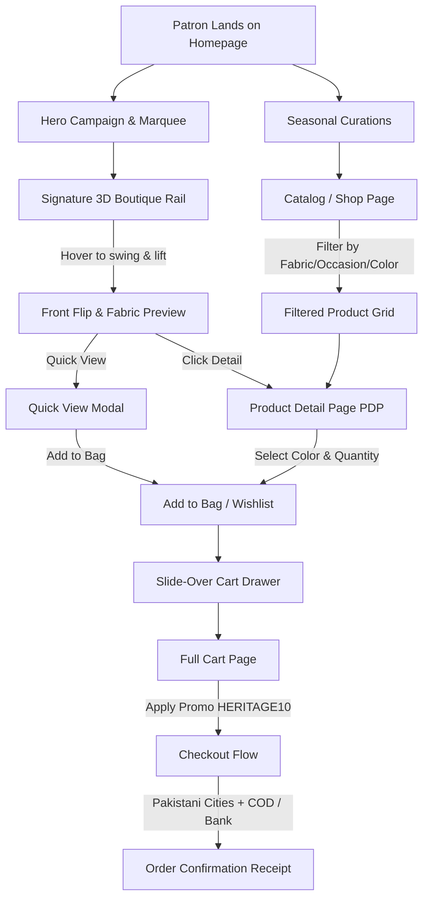

<div align="center">

# ✦ THE HERITAGE EDIT ✦
### *Contemporary Pakistani Luxury · Unstitched Collections*

[](https://react.dev/)
[](https://www.typescriptlang.org/)
[](https://tailwindcss.com/)
[](https://www.framer.com/motion/)
[](https://vitejs.dev/)

<p align="center">
  <b>An international luxury editorial e-commerce platform celebrating centuries-old Pakistani textile heritage, Swiss lawn, pure silk organza, and artisanal zardozi needlework.</b>
</p>

[Explore Features](#-signature-features) • [Architecture](#-architecture--user-flow) • [Tech Stack](#-technology-stack) • [Folder Structure](#-folder-structure) • [Development Phases](#-development-phases) • [Quick Start](#-getting-started)

---

</div>

## 📖 Project Vision & Purpose

**The Heritage Edit** is built to break away from generic, predictable e-commerce layouts. In South Asian fashion culture, an **unstitched suit** is the purest canvas of personal style: high-thread-count fabric tailored specifically to a woman's unique proportions, adorned with her preferred neckline, sleeve cut, and silhouette.

### 🌟 Design Philosophy: *Editorial Luxury & Quiet Craftsmanship*
1. **Fashion Editorial Art Direction:** High-contrast serif headlines (*Cormorant Garamond*), ultra-clean geometric sans body text (*Manrope*), spacious 8px-grid layouts, and rich tonal palette (`#F8F4ED` Ivory, `#E8DED0` Champagne, `#49352F` Mocha, `#762E3C` Burgundy).
2. **Authentic Cultural Identity:** Genuine Pakistani terminology (3-Piece sets, Swiss Lawn, Chiffon, Cambric, Organza, Zardozi, Tilla, Kora Dabka) with PKR (`Rs.`) pricing and Pakistani cities (Lahore, Karachi, Islamabad, Multan, Peshawar, etc.).
3. **No AI Slop Standard:** Eliminates arbitrary purple-blue gradients, repetitive 3-card templates, and gratuitous glow effects in favor of purposeful composition, physical depth, and tactile motion physics.

---

## ✨ Signature Features

### 1. 🧥 The Signature 3D Boutique Clothes Rail (`HangingRail.tsx`)
Inspired by physical luxury atelier closet racks (e.g. Puma/Aura references):
- **Perpendicular Wardrobe Profile:** By default, garments hang perpendicular to the brushed-brass rail rod, **facing to the left** at `-65deg` on the Y-axis.
- **Wave & Swing Physics:** Hovering over any garment triggers a realistic fabric wave oscillation (`rotateZ: [0, -3.5, 2.5, -1, 0]`), swinging it forward into a front-facing perspective (`rotateY: 0deg`).
- **Pop-Up Elevation:** The selected garment lifts off the rack (`y: -26px`, `scale: 1.16`), casting a rich dual-layer shadow on the floor.
- **Depth-of-Field Blur:** All unselected garments on the rack dynamically blur out (`blur(3.5px)`, `brightness(0.65)`, `opacity: 0.42`) to spotlight the chosen masterpiece.
- **Unified 3D Assembly:** The wire hook, mahogany hanger body with brass swivel, fabric fold drape, and shadow all rotate together as a cohesive physical object.

### 2. 🪡 Fabric-to-Tailored Silhouette Hover Transformation
- Unstitched fabric flat-lay is showcased initially.
- On hover, smooth opacity crossfade reveals the tailored stitched ensemble worn by a model, demonstrating how the unstitched suit transforms when crafted.

### 3. 🔍 Luxury Quick View Modal
- Centered modal with subtle backdrop blur, high-resolution zoom gallery, color swatches, piece breakdown (Shirt / Dupatta / Trouser specifications), and instant Cart/Wishlist integration.

### 4. 🛍️ End-to-End Pakistani E-Commerce Flow
- **Multi-parameter Filtering:** Instant filtering by Category (Lawn, Chiffon, Festive, Formals), Fabric Type, Occasion, Color swatch, and Price Range with URL query param sync.
- **Cart Drawer & Cart Page:** Slide-over drawer with free shipping progress bar (threshold `Rs. 5,000`), coupon code engine (`HERITAGE10` for 10% off), and item counters.
- **Checkout Engine:** Address inputs tailored for Pakistan (20+ major cities), Cash On Delivery (COD), Direct Bank Transfer, and Card options.
- **Order Confirmation:** Order receipt generator with unique order codes (e.g., `HE-78421`), itemized summary, and print receipt capability.
- **Patron Reviews & Community:** Verified rating breakdown, customer review submissions, and star distributions.

---

## 📐 Architecture & User Flow



### 🧠 State Management Architecture
The application runs on four zero-dependency, high-performance React Context providers:
```
ToastProvider
 └── AuthProvider (Demo Patron: Ayesha Ahmed, Order History, Address Book)
      └── CartProvider (Persistent Cart, Promo Codes, Free Shipping Threshold)
           └── WishlistProvider (Persistent Saved Ensembles)
                └── BrowserRouter (React Router DOM v7)
```

---

## 🛠️ Technology Stack

| Layer | Technology | Purpose |
|---|---|---|
| **Framework** | React 19 + TypeScript | Component model, type-safe interfaces, modern hooks |
| **Bundler** | Vite 6 | Sub-second HMR, optimized tree-shaken production bundles |
| **Styling** | Tailwind CSS v4 (`@theme`) | CSS custom properties, utility styling, responsive grid |
| **Animation** | Framer Motion 12 | 3D physics, spring dampening, pendulum swings, page transitions |
| **Routing** | React Router DOM v7 | Dynamic client-side routing, query parameter sync |
| **Icons** | Lucide React | Minimalist line icons |
| **Typography** | Google Fonts | Cormorant Garamond (Serif display) + Manrope (Sans text) |

---

## 📂 Folder Structure

```
Clothing_Website/
├── public/
│   ├── images/                        # High-resolution Pakistani luxury fashion assets
│   │   ├── hero_bridal.jpg            # Royal bridal crimson & gold zardozi campaign
│   │   ├── model_emerald.jpg          # Emerald green silk formal salwar suit
│   │   ├── fabric_emerald.jpg         # Folded Swiss lawn unstitched fabric flat-lay
│   │   ├── model_rose.jpg             # Dusty rose chiffon tailored suit
│   │   ├── fabric_rose.jpg            # Folded rose chiffon fabric flat-lay
│   │   └── model_mustard.jpg          # Festive mustard lawn in haveli courtyard
│   ├── favicon.svg                    # Brand favicon
│   └── icons.svg
├── src/
│   ├── assets/                        # Static bundled assets
│   ├── components/
│   │   ├── cart/
│   │   │   └── CartDrawer.tsx         # Slide-over cart with free shipping bar & items
│   │   ├── layout/
│   │   │   ├── Navbar.tsx             # Editorial header, mega-nav, search & badges
│   │   │   ├── Footer.tsx             # Brand footer, newsletter, craft guarantees
│   │   │   ├── SearchOverlay.tsx      # Real-time search modal with category pills
│   │   │   └── ScrollToTop.tsx        # Automatic route scroll restoration
│   │   ├── product/
│   │   │   ├── ProductCard.tsx        # Fabric-to-model hover crossfade card
│   │   │   ├── ProductGrid.tsx        # Responsive product display grid
│   │   │   ├── ProductFilters.tsx     # Filter sidebar (fabric, price, occasion, color)
│   │   │   └── QuickViewModal.tsx     # Centered quick view modal with gallery & specs
│   │   ├── sections/
│   │   │   └── HangingRail.tsx        # 3D interactive closet rail with spring wave flip
│   │   └── ui/
│   │       ├── Breadcrumbs.tsx        # Accessible navigation breadcrumbs
│   │       ├── LoadingSkeleton.tsx    # Shimmer placeholder loaders
│   │       ├── Newsletter.tsx         # Editorial newsletter subscription
│   │       ├── ReviewCard.tsx         # Verified patron testimonial card
│   │       └── SortDropdown.tsx       # Custom price/popularity sort dropdown
│   ├── context/
│   │   ├── AuthContext.tsx            # Patron session, profile, addresses, orders
│   │   ├── CartContext.tsx            # Bag state, quantities, coupon HERITAGE10
│   │   ├── WishlistContext.tsx        # Saved items state
│   │   └── ToastContext.tsx           # Floating notification toasts
│   ├── data/
│   │   └── products.ts                # 20 luxury products, 6 collections, 8 reviews
│   ├── hooks/
│   │   ├── useInView.ts               # Intersection observer trigger
│   │   └── useScrollLock.ts           # Body scroll locking for modal dialogs
│   ├── pages/
│   │   ├── HomePage.tsx               # Hero, 3D rail, collections, new arrivals, editorial
│   │   ├── ShopPage.tsx               # Catalog with filter sidebar & sorting
│   │   ├── CollectionsPage.tsx        # Seasonal archives
│   │   ├── CollectionDetailPage.tsx   # Dynamic slug collection view
│   │   ├── ProductPage.tsx            # Full PDP with 3 views, accordions, related items
│   │   ├── AboutPage.tsx              # Craft story, artisan clusters, atelier values
│   │   ├── ReviewsPage.tsx            # Ratings overview, filter tabs, review submission
│   │   ├── CartPage.tsx               # Full shopping cart with shipping calculator
│   │   ├── CheckoutPage.tsx           # Pakistani cities, COD / bank transfer options
│   │   ├── OrderConfirmationPage.tsx  # Order summary, receipt breakdown
│   │   ├── WishlistPage.tsx           # Saved items gallery with Add All to Bag
│   │   ├── AuthPage.tsx               # Login/Register with 1-click Demo Patron login
│   │   ├── AccountPage.tsx            # Order history, address book, profile settings
│   │   └── NotFoundPage.tsx           # Editorial 404 page
│   ├── types/
│   │   └── index.ts                   # Strict TypeScript contracts for models
│   ├── utils/
│   │   └── helpers.ts                 # formatPrice (PKR), slugify, order IDs
│   ├── App.tsx                        # Router configuration & provider hierarchy
│   ├── App.css
│   ├── index.css                      # Tailwind v4 @theme, custom scrollbars, keyframes
│   └── main.tsx                       # Vite React root mounting
├── index.html                         # Document root, Cormorant + Manrope font links
├── package.json
├── tsconfig.app.json
├── tsconfig.json
└── vite.config.ts                     # Vite configuration with Tailwind CSS v4 plugin
```

---

## 🚀 Development Phases

| Phase | Milestone | Deliverables |
|---|---|---|
| **Phase 1** | *Foundation & Shell* | Design token palette (`#F8F4ED` Ivory, Mocha, Burgundy), Navbar, Footer, Providers (Auth, Cart, Wishlist, Toast). |
| **Phase 2** | *Components & Interactions* | ProductCard with front/back crossfade, QuickViewModal, ProductFilters, Breadcrumbs, SortDropdown. |
| **Phase 3** | *Full Page Ecosystem* | 14 responsive pages: Home, Shop, Collections, Detail PDP, About, Reviews, Cart, Checkout, Order Confirmation, Auth, Account, Wishlist, 404. |
| **Phase 4** | *Signature 3D Closet & Typography* | HangingRail with 3D profile-facing `-65deg` angle, fabric pendulum wave on hover, background blur, custom Pakistani fashion assets, and gigantic editorial serif titles. |

---

## 💻 Getting Started

### Prerequisites
- [Node.js](https://nodejs.org/) (version `v18.0.0` or higher recommended)
- `npm` or `pnpm`

### Installation
1. Clone the repository:
   ```bash
   git clone https://github.com/MuhammadAnasBilal/Clothing_Website.git
   cd Clothing_Website
   ```

2. Install dependencies:
   ```bash
   npm install
   ```

3. Launch development server:
   ```bash
   npm run dev
   ```
   Open `http://localhost:5173/` in your browser.

4. Build for production:
   ```bash
   npm run build
   ```
   Output will be generated in `dist/`.

5. Preview production build:
   ```bash
   npm run preview
   ```

---

## 🎨 Color Palette & Design Tokens

```css
--color-ivory:      #F8F4ED;  /* Primary warm background */
--color-champagne:  #E8DED0;  /* Secondary accent & subtle borders */
--color-mocha:      #49352F;  /* Deep rich brown typography & buttons */
--color-taupe:      #9B7865;  /* Subtle editorial labels */
--color-burgundy:   #762E3C;  /* Heritage regal Pakistani accent */
--color-charcoal:   #292321;  /* High-contrast dark backgrounds */
--color-warm-grey:  #786D65;  /* Body copy text */
--color-border:     #E5DDD3;  /* Restrained hairline dividers */
```

---

<div align="center">
  <sub>Crafted with passion for authentic Pakistani textile heritage. Designed for an uncompromising, high-end international digital experience.</sub>
</div>
